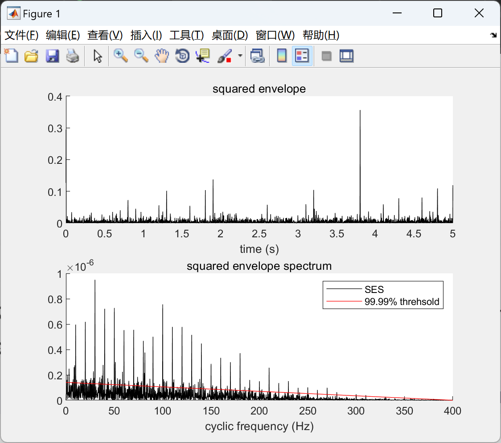
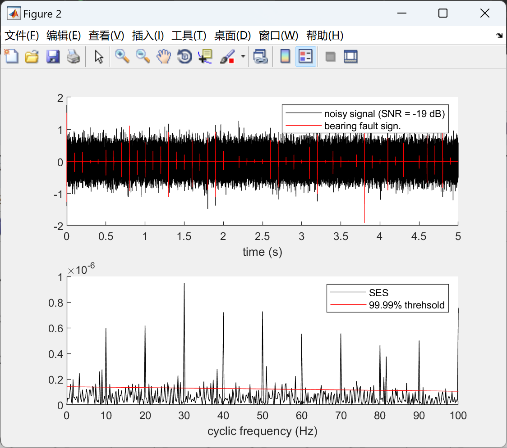

# Bearing Fault Detection [Application of Spectral Pre-whitening Technique in Diagnosing Bearing Faults under Variable Speed Conditions] Square Envelope Spectrum after Bandpass Filtering is used for bearing fault detection.

[Bearing Fault Detection][Application of Inverse Spectral Pre-whitening Technique in Diagnosing Bearing Faults under Variable Speed Conditions]The square envelope spectrum after bandpass filtering is used for bearing fault detection (Matlab code implementation)

## Images

<!-- PAYMENT_BLOCK -->

## Get this dataset

- Payment link (Stripe): [Buy now](https://buy.stripe.com/3cs8yP7sY87d0vu9AB)
- Payment QR code: 

<!-- /PAYMENT_BLOCK -->
